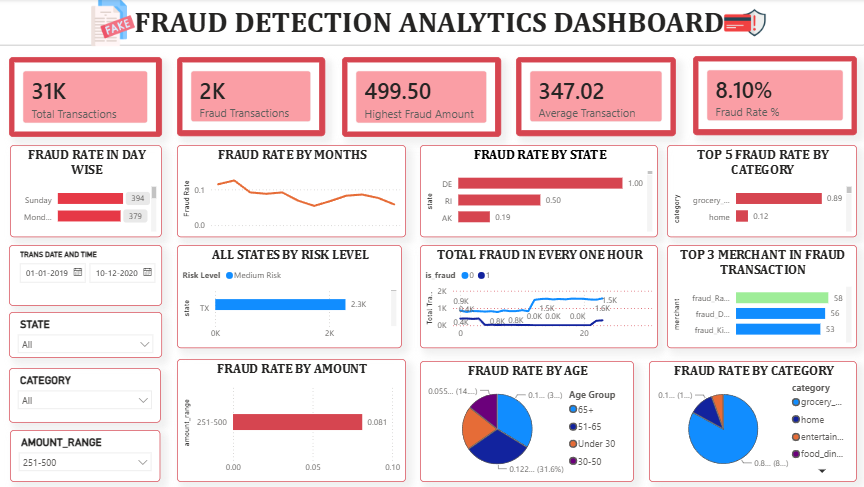

# 🛡️ Fraud Detection Analytics Dashboard

An end-to-end data analytics project that analyses credit card transactions to identify fraud patterns, measure risk, and present insights through an interactive Power BI dashboard.

**Workflow:** Raw Data → Python Cleaning → MySQL Analysis → Power BI Dashboard → Business Insights



## 📌 Project Overview
Fraudulent transactions are hidden among a large volume of genuine ones. This project answers:
- How many transactions are fraudulent, and what is the fraud rate?
- Which categories, states and merchants have the highest fraud?
- When does fraud happen (hour, weekday, month)?
- Which age groups and amount ranges are most at risk?

## 📊 Dataset
Credit card transaction data (train and test files combined) with customer, merchant, location, amount and time details. The target column is `is_fraud` (0 = genuine, 1 = fraud). The data is highly imbalanced.
Source: <https://www.kaggle.com/datasets/kartik2112/fraud-detection?utm_source=chatgpt.com>

## 🛠️ Tools & Technologies
| Tool | Purpose |
|------|---------|
| 🐍 Python (pandas, NumPy) | Data cleaning and feature engineering |
| 📈 matplotlib, seaborn | Exploratory data analysis |
| 🗄️ MySQL | Business analysis with SQL |
| 📊 Power BI | Interactive dashboard |

## 🐍 Phase 1: Data Cleaning with Python (`fraud_analysis.ipynb`)
- Merged train and test files
- Checked data types, duplicates and null values
- Dropped unneeded columns (`Unnamed: 0`, `unix_time`, `street`)
- Created features: month, day, hour, weekday, customer age, amount range
- Saved `fraud_cleaned.csv` and explored fraud by category, hour, month, state, gender, age and amount

## 🗄️ Phase 2: SQL Analysis (`fraud_analysis_queries.sql`)
Concepts used: `WHERE`, `GROUP BY`, `HAVING`, `CASE`, subqueries, CTEs, window functions (`RANK`, running totals), self-joins, lookup-table joins and a view.
Questions answered: fraud rate by category / state / month / age group / risk level, top merchants, repeat-fraud cards, night-time fraud.

## 📊 Phase 3: Power BI Dashboard
**KPIs:** Total Transactions · Fraud Transactions · Highest Fraud Amount · Average Transaction · Fraud Rate %

**Visuals:** fraud by weekday · fraud rate by month, state, category, amount and age · risk level by state · fraud by hour · top merchants in fraud · slicers for date, state, category and amount range.

## 🔍 Key Insights
- **Overall fraud rate:** ~0.52% of ~1.85M transactions (highly imbalanced data)
- **Highest-risk categories:** shopping_net (~1.6%), misc_net (~1.3%), grocery_pos (~1.3%)
- **Fraud peaks during:** 10 PM to 3 AM (up to ~2.5% at 10-11 PM vs ~0.1% in the daytime)
- **Highest-risk age group:** 70+ (~0.71%), followed by 50-60 and 60-70
- **Top merchants by fraud count:** Kilback LLC (62), Rau and Sons (60), Kozey-Boehm (60), Doyle Ltd (57), Terry-Huel (56)
- **Amounts:** fraud transactions average ~530 vs ~68 for genuine ones

## 📁 Project Structure
```
├── fraud_analysis.ipynb
├── fraud_analysis_queries.sql
├── fraud_dashboard.png
└── README.md
```
Large data files and the Power BI file are not included because of GitHub size limits.

## 🚀 How to Reproduce
1. Download the dataset from the link above
2. Run `fraud_analysis.ipynb` to create `fraud_cleaned.csv`
3. Run `fraud_analysis_queries.sql` in MySQL (update the CSV path in `LOAD DATA`)
4. Build or open the Power BI dashboard on the cleaned data

## 📚 Skills Demonstrated
Data cleaning · EDA · Python · pandas · SQL (CTEs, window functions) · Power BI · DAX · KPI design · Dashboard design · Fraud analytics
